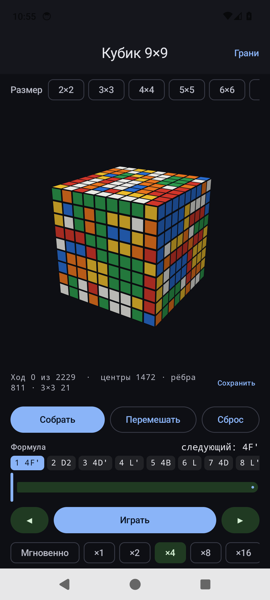
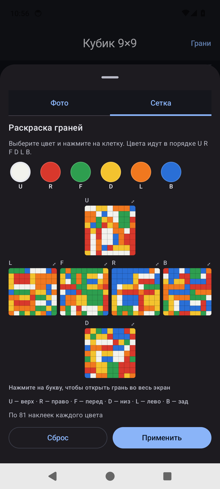
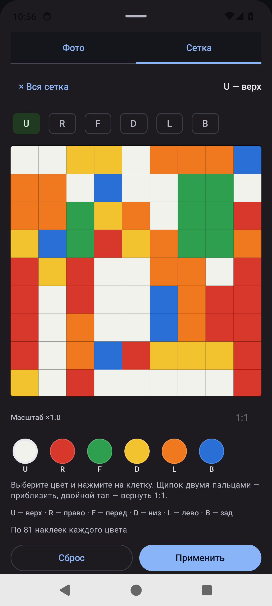

# Rubik N×N — решатель кубика 2×2…12×12 для Android

[](https://github.com/alex79ven/RubikNxN/actions/workflows/android.yml)
[](LICENSE)

Приложение собирает кубик Рубика любого размера от 2×2 до 12×12. Состояние
вводится вручную по сетке граней или снимается камерой, решение считает
нативный C++-движок, а приложение показывает его формулой, проигрывает по
шагам и сохраняет прогресс, даже если сборка растянулась на несколько дней.

<p align="center">
  
  
  
</p>

## Скачать

Готовый APK лежит в разделе [Releases](../../releases/latest).

- `minSdk 26` (Android 8.0), `targetSdk 35`;
- ABI: `arm64-v8a`, `armeabi-v7a`, `x86_64` — телефоны и эмулятор;
- APK подписан release-ключом проекта.

## Возможности

- **Размеры 2×2…12×12** (движок умеет больше, в интерфейсе ограничено ради
  скорости и вёрстки).
- **Два способа ввода:** ручная раскраска сети граней и съёмка грани камерой
  с автоматическим распознаванием цветов и проверкой результата перед
  применением.
- **Удобное редактирование больших граней:** грань открывается во весь экран,
  масштабируется щипком, двойной тап возвращает 1:1.
- **Формула решения:** крупно видны текущий и следующий ход, лента всех ходов
  пронумерована, подсвечивает текущий и автоматически прокручивается.
- **Проигрывание:** пауза/продолжение, перемотка по одному ходу, скорости
  ×1…×16 и мгновенная прокрутка до конца.
- **Сохранение сессии:** автосохранение каждые 1,5 с, при уходе в фон, вручную
  и при закрытии; состояние переживает закрытие приложения, принудительную
  остановку и падение.
- **Проверка решения:** нативное решение проигрывается в Kotlin-модели и
  сверяется с собранным состоянием до того, как его увидит пользователь.

## Сколько ходов

Сведение (reduction) собирает центры и рёбра 3-циклами. Для каждого цикла
сразу ищется кратчайшая установка (setup) в пространстве упорядоченных троек
слотов: multi-source BFS стартует из всех 24 поворотов куба × 6 ориентаций
чистого 8-ходового цикла и выбирает минимальный вариант `setup⁻¹ · цикл · setup`.
Это дало примерно пятикратное сокращение по сравнению с реализацией через
сопряжение генераторов орбиты.

Замеры на host-бенчмарке (Release, seed 7, ходы после схлопывания):

| Размер | Было ходов | Стало ходов | Ускорение |
| ------ | ---------: | ----------: | --------: |
| 4×4    |      1 497 |         302 |     5,0× |
| 6×6    |      4 604 |         971 |     4,7× |
| 8×8    |      9 465 |       1 936 |     4,9× |
| 9×9    |     11 530 |       2 253 |     5,1× |
| 10×10  |     15 264 |       3 122 |     4,9× |
| 11×11  |     17 704 |       3 437 |     5,2× |
| 12×12  |     22 102 |       4 401 |     5,0× |

На телефоне/эмуляторе 9×9 решается примерно за 6 с (около 2 200 ходов),
12×12 — за 10–15 с (около 4 400 ходов), включая проверку решения.

### Почему в платных приложениях видно ~400 ходов

При честном счёте «один слой — один ход» случайный 9×9 у людей требует
порядка 1 200–2 000 ходов (мировой рекорд 9×9 — 4:53), у нас — около 2 200.
Оценка для метода сведения 3-циклами: одиночный 8-ходовый цикл на 294 центрах
и 84 рёбрах даёт ~1 000 ходов без установок, а батчевые 4-ходовые двойные
3-циклы (6 деталей за 4 хода) опускают оценку до ~550–700 с установками.
То есть 10× от исходных 11 530 (≈1 150) — у самой границы метода, а не
«невозможно»; 400 ходов в этой метрике потребовали бы почти бесплатных
установок и другой архитектуры (блочная сборка/freeslice).

В приложениях, которые показывают ~400 движений для 9×9, почти всегда другая
метрика или другая задача:

- широкий ход (`3Rw`) считается за один ход, хотя физически это три слоя —
  отсюда разница в 3–5 раз;
- приложение решает только собственный скрамбл и показывает его обращение;
- один коммутатор или «этап» считается за одно движение;
- куб распознан частично, и решение выходит коротким.

Проверить просто: посмотрите, есть ли в формуле `w`/`Rw` и сколько слоёв
реально поворачивает один «ход», и предложите приложению скрамбл, сделанный
другим приложением или вручную.

## Как это устроено

```
rubik/src/main/java/com/ledbadge/rubik/
  cube/CubeModel.kt        модель наклеек и ходов, нотация, скрамблер
  cube/NativeSolver.kt     JNI-обвязка
  cube/CubeStateStore.kt   сохранение сессии (AtomicFile)
  ui/CubeViewModel.kt      состояние, решение, проигрывание, автосохранение
  ui/CubeScreen.kt         главный экран и лента формулы
  ui/NetEditor.kt          сетка граней и полноэкранный редактор с зумом
  ui/CameraEditor.kt       съёмка грани и распознавание цветов
  ui/CubeCanvas.kt         3D-отрисовка куба на Compose
rubik/src/main/cpp/
  native_solver.cpp        JNI-мост, проверка и воспроизведение решения
  engine/                  встроенный MIT-движок (см. engine/LICENSE)
```

- Kotlin-модель — точный порт нативной: `index = face·n² + row·n + col`,
  циклы полос из `outer_table`. Поэтому любое решение движка можно
  прокручивать в приложении и проверять на собранность.
- 2×2 решается паддингом до 3×3 с перестановкой UF↔UR.
- Ход кодируется как `face | outer << 3 | inner << 9 | turn << 15`.
- Сессия хранится в приватном хранилище через `AtomicFile`; запись
  атомарная, поэтому обрыв питания не оставляет битый файл.
- Решение не показывается, пока не проиграно в Kotlin-модели и не сверено
  с собранным состоянием.

## Тесты

- `CubeModelTest` (JVM): эталонные раскраски, посчитанные тем же C++-движком,
  обратимость ходов, нотация, скрамблер.
- `NativeSolverTest` (instrumented): скрамбл → нативный солвер → прокрутка
  решения в Kotlin → куб собран; для 2×2, 3×3, 4×4, 7×7, 9×9 и проверка
  отказа на неразрешимом состоянии.
- `CubeStateStoreTest` (instrumented): запись и чтение сессии.

```bash
./gradlew :rubik:testDebugUnitTest
./gradlew :rubik:connectedDebugAndroidTest   # нужен запущенный эмулятор/устройство
```

## Сборка

Нужны JDK 17, Android SDK 35, NDK `27.0.12077973` и CMake `3.22.1`.

```bash
git clone https://github.com/alex79ven/RubikNxN.git
cd RubikNxN
echo "sdk.dir=$HOME/Library/Android/sdk" > local.properties
./gradlew :rubik:assembleDebug
```

APK: `rubik/build/outputs/apk/debug/rubik-debug.apk`.

Release-сборка:

```bash
./gradlew :rubik:assembleRelease
BT=$HOME/Library/Android/sdk/build-tools/35.0.0
$BT/zipalign -p -f 4 rubik/build/outputs/apk/release/rubik-release-unsigned.apk aligned.apk
$BT/apksigner sign --ks release.jks --ks-key-alias rubik --out Rubik-1.0.apk aligned.apk
```

`local.properties` и ключи в репозиторий не коммитятся.

## Лицензия

Код приложения распространяется по MIT — см. [LICENSE](LICENSE).

Встроенный движок — [krishvijay100/NxN-Cube-Solver-Engine](https://github.com/krishvijay100/NxN-Cube-Solver-Engine),
MIT © Krish Vijay; текст лицензии сохранён в
[`rubik/src/main/cpp/engine/LICENSE`](rubik/src/main/cpp/engine/LICENSE).
Файл `reduction_general.cpp` существенно доработан: добавлены прямой поиск
установок, повороты куба и батчевые генераторы, удалён старый код сопряжения.

## English

An Android app that solves Rubik's cubes from 2×2 to 12×12. Enter the state on
a face net or capture each face with the camera; a native C++ solver computes
the solution, shown as a numbered formula with seek/playback and multiple
speeds. Sessions are auto-saved and survive app restarts and crashes. Release
APKs are in [Releases](../../releases/latest); see the sections above for the
architecture, move counts and build instructions. MIT licensed.
